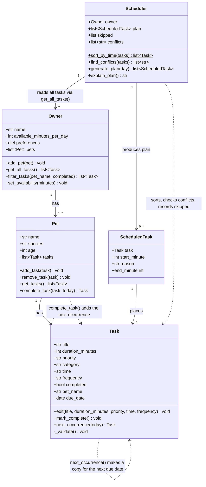

# PawPal+ UML Class Diagram (final)

This matches the final `pawpal_system.py`. The Mermaid source is also saved as
[diagrams/uml_final.mmd](diagrams/uml_final.mmd).

## What changed from the initial design

- **Task** gained `time`, `frequency` and `due_date`, validation, `next_occurrence()`, and a wider `edit()`.
- **Pet** gained `complete_task()`, which marks a task done and adds the next occurrence of repeating tasks.
- **Owner** gained `filter_tasks()` (by pet and/or status).
- **ScheduledTask** is new: a task placed at a start time, with the reason it was placed there.
- **Scheduler** gained `sort_by_time()` and `find_conflicts()` (static, so they work on any list of tasks), `conflicts`, and `skipped`. `generate_plan()` takes an optional day. The old `explanations` dict was replaced by `ScheduledTask.reason`.
- **Relationships:** the Scheduler reads tasks only through `Owner.get_all_tasks()`, so one plan covers every pet. `Pet` and `Task` also create new `Task` objects when a task repeats.

Not shown: the module-level helpers `parse_time()` and `format_time()` and the constants `PRIORITY_ORDER`, `FREQUENCIES`, `RECURRENCE_DAYS` and `DAY_START_MINUTE`.
